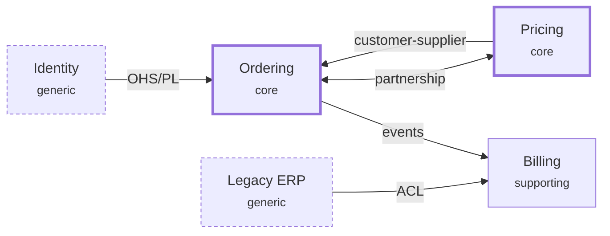

# Context-map diagram notation

A project's `context-map.md` carries an **authored** diagram alongside its prose. The dashboard does not derive it; GitHub and VS Code render it natively.

## Placement

A `## Diagram` section sits between `## Contexts` and `## Relationships`. It holds exactly one `mermaid` fence starting with `flowchart LR`.

## Nodes

One node per `### <Context>` heading under `## Contexts`. The node id is the context's kebab-case name. The label is `"<Context name> <small>core|supporting|generic</small>"`. Each node gets a class suffix `:::core`, `:::supporting`, or `:::generic`.

## Classification styling is theme-neutral

Each `classDef` uses stroke width and dash only. Never `fill`, `color`, or a colour in `stroke` — the dashboard's token theming controls colour.

## Edges

One edge per relationship in `## Relationships`. Directional edges point **upstream to downstream** (`U --> D`). Edge labels use this fixed vocabulary:

- `customer-supplier` — `U -->|customer-supplier| D`
- `conformist` — `U -->|conformist| D`
- `ACL` — on the downstream side's edge, `U -->|ACL| D`
- `OHS/PL` — `U -->|OHS/PL| D`
- `events` — publisher to subscriber, when no DDD label fits
- Symmetric relationships use `<-->`: `partnership`, `shared kernel`
- Separate-ways pairs get **no edge**

## Example

## Rules

- **Prose wins.** The diagram is a view of `## Relationships`. On conflict the prose is right and the diagram gets fixed.
- **Only the strategic-modeler (and brainstorm, when it first writes the map) edits the diagram.** A worker's `README_DELTA` can only append bullets, so workers report the prose relationship only; the strategic-modeler reconciles the diagram the next time it touches the map, so the diagram may briefly lag.
- **Backfill when next touched.** A prose-only map gets its diagram the next time the strategic-modeler updates it. There is no migration step.
